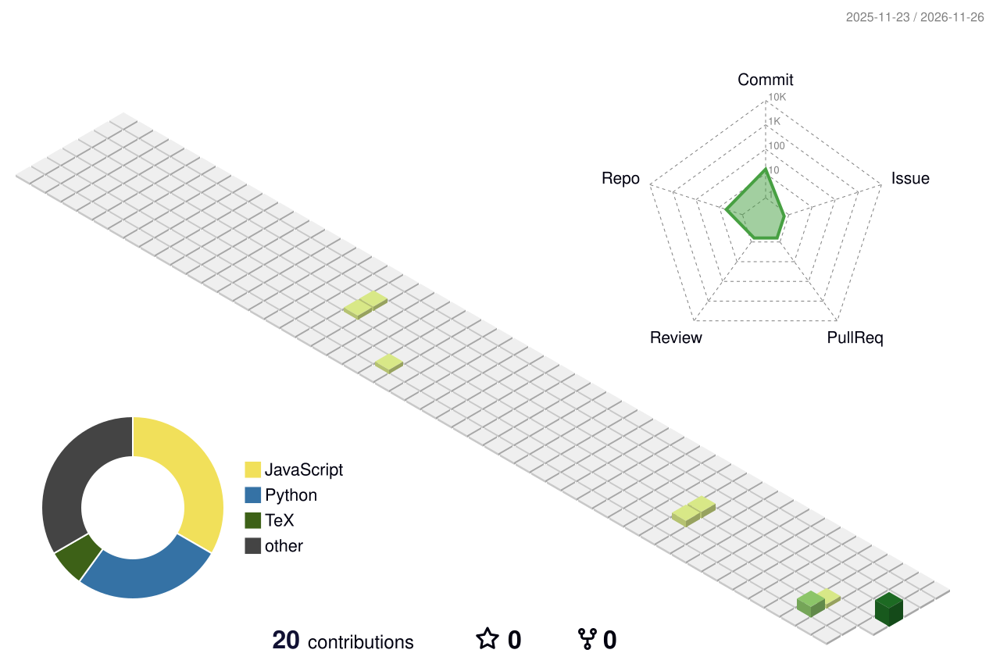

<p align="center">
  <a href="https://mohitgora950.github.io">
    
  </a>
</p>

<p align="center">
  <a href="https://mohitgora950.github.io"></a>
  <a href="https://mohitgora950.github.io/assets/Mohit_Gora_Resume.pdf"></a>
  <a href="https://www.linkedin.com/in/mohit-goraaaa1234/"></a>
  <a href="mailto:mohitgora950@gmail.com"></a>
  <a href="https://leetcode.com/u/momon950/"></a>
</p>

<p align="center">
  
  
  
</p>

## 👨‍💻 About me

```js
const mohit = {
  role:       "Software & AI/ML Engineer",
  education:  "B.Tech CSE @ IIIT Manipur (2023 – 2027)",
  experience: ["Data Scientist Associate Intern @ Blackcoffer (May – Aug 2025)"],
  building:   ["LLM services on Kubernetes", "Full-stack platforms", "Computer vision apps"],
  learning:   ["Transformers (encoder / decoder)", "RAG", "MLOps"],
  certified:  ["C++ (IIT Bombay)", "MongoDB"],
  openTo:     ["Full-time roles", "Internships", "Startup collaborations"],
  funFact:    "I built a dragon game where you burn banners to unlock my repos 🐉",
};
```

- 🤖 I take ideas from **notebook to production**: model, API, container, cluster, CI/CD
- 🌐 I build **full-stack apps** with auth, analytics and real users in mind
- 🧠 I practise **DSA in C++** and enjoy turning messy problems into clean systems

## 🚀 Featured projects

<p align="center">
  <a href="https://github.com/mohitgora950/cloud"></a>
  <a href="https://github.com/mohitgora950/professor-rating-app"></a>
  <a href="https://github.com/mohitgora950/Local-sign-language"></a>
  <a href="https://github.com/mohitgora950/mohitgora950.github.io"></a>
</p>

<p align="center"><sub>Click a card to open the repository · More in <a href="https://github.com/mohitgora950?tab=repositories"><b>Repositories</b></a></sub></p>

## 🛠️ Tech stack

<p align="center">
  <b>Languages</b><br />
  <br /><br />
  <b>Backend & data</b><br />
  <br /><br />
  <b>AI / ML & cloud</b><br />
  <br /><br />
  <b>Tools</b><br />
  
</p>

## 📈 GitHub activity

<p align="center">
  
  
</p>

<p align="center">
  <picture>
    <source media="(prefers-color-scheme: dark)" srcset="https://raw.githubusercontent.com/mohitgora950/mohitgora950/output/ember-snake.svg" />
    <source media="(prefers-color-scheme: light)" srcset="https://raw.githubusercontent.com/mohitgora950/mohitgora950/output/github-snake.svg" />
    
  </picture>
</p>

<p align="center">
  <picture>
    <source media="(prefers-color-scheme: dark)" srcset="./profile-3d-contrib/profile-night-view.svg" />
    <source media="(prefers-color-scheme: light)" srcset="./profile-3d-contrib/profile-green-animate.svg" />
    
  </picture>
</p>

## 🎓 For students

Learning something new? My repos are written to be **read and forked**, each with setup steps and notes:

| If you want to learn… | Start with |
|---|---|
| Knowledge distillation, Docker, Kubernetes, CI/CD | [`cloud`](https://github.com/mohitgora950/cloud) |
| Full-stack auth (JWT), REST APIs, MySQL, dashboards | [`professor-rating-app`](https://github.com/mohitgora950/professor-rating-app) |
| Computer vision with MediaPipe + OpenCV | [`Local-sign-language`](https://github.com/mohitgora950/Local-sign-language) |
| DOM manipulation and `localStorage` basics | [`phoneBook`](https://github.com/mohitgora950/phoneBook) |
| Three.js, canvas games, GitHub Pages | [`mohitgora950.github.io`](https://github.com/mohitgora950/mohitgora950.github.io) |

⭐ Star what helps you, open an issue if you get stuck, and feel free to message me on LinkedIn about projects or DSA.

## 🤝 For recruiters & startups

I'm a **final-year CSE engineer (2027)** who has shipped an LLM service on Kubernetes, a role-based full-stack platform and a real-time CV app, plus a **Data Science internship** with global clients.

**Open to:** SDE · Full-Stack · AI/ML · Data roles, internships and early-stage startups (remote or on-site).
If the problem is interesting, I'll commit to it fully.

<p align="center">
  <a href="https://mohitgora950.github.io/assets/Mohit_Gora_Resume.pdf"></a>
  <a href="mailto:mohitgora950@gmail.com"></a>
  <a href="https://www.linkedin.com/in/mohit-goraaaa1234/"></a>
</p>

## 🐉 Just for fun

<p align="center">
  <a href="https://mohitgora950.github.io/dragon.html">
    
  </a>
  <br />
  <sub>A playable dragon game: burn the banners, unlock my repos and beat the Frost Wyrm. <a href="https://mohitgora950.github.io/dragon.html"><b>Play it →</b></a></sub>
</p>

<p align="center">
  
</p>
